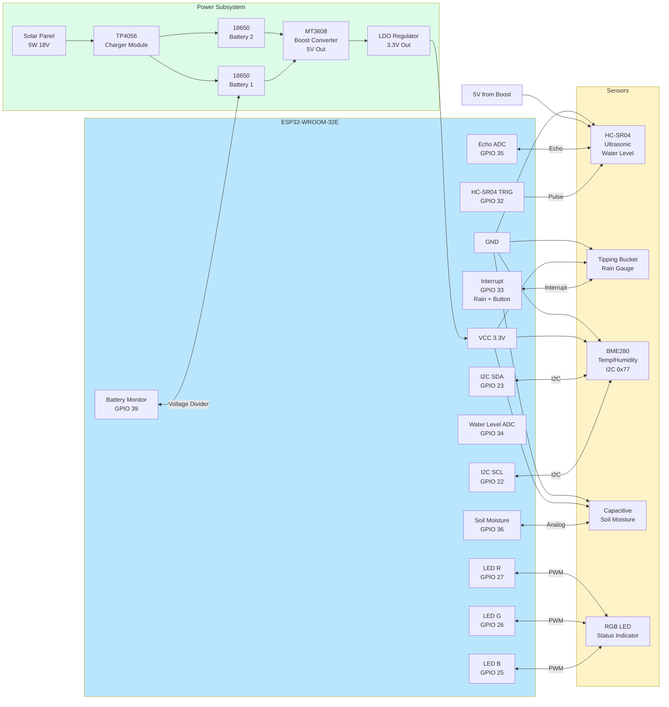
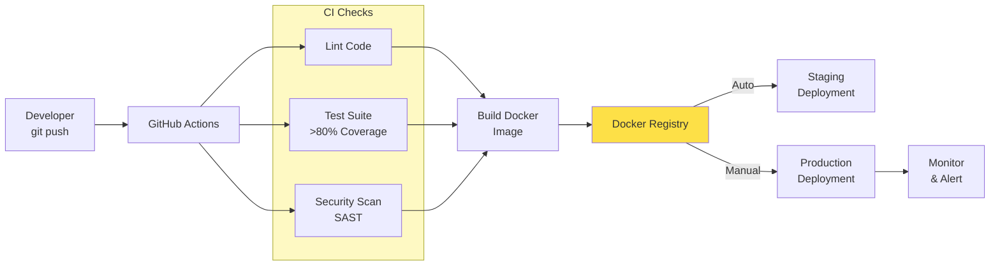
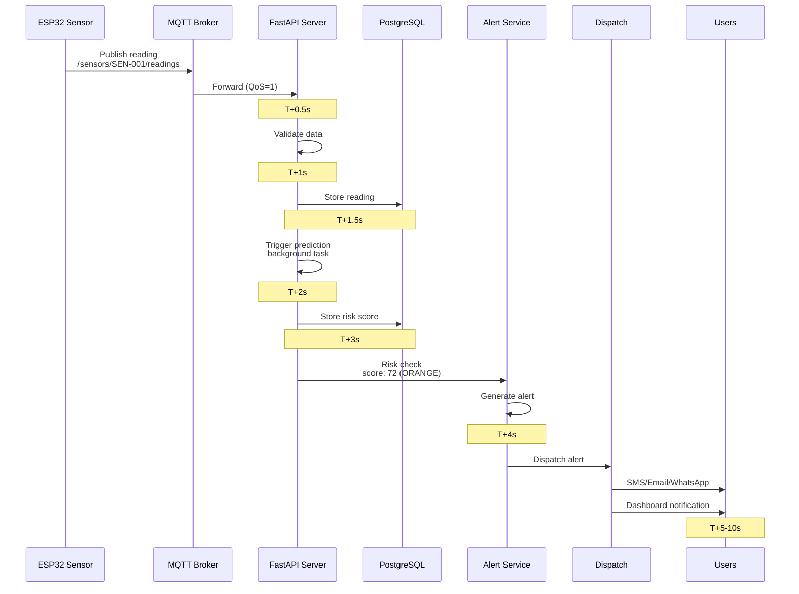
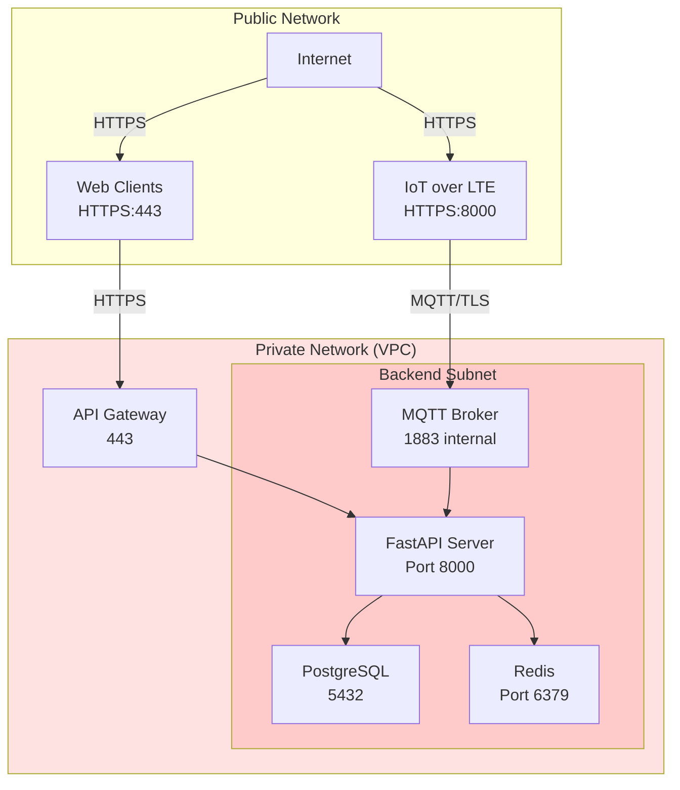
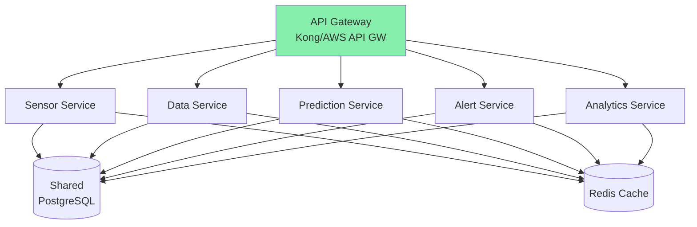
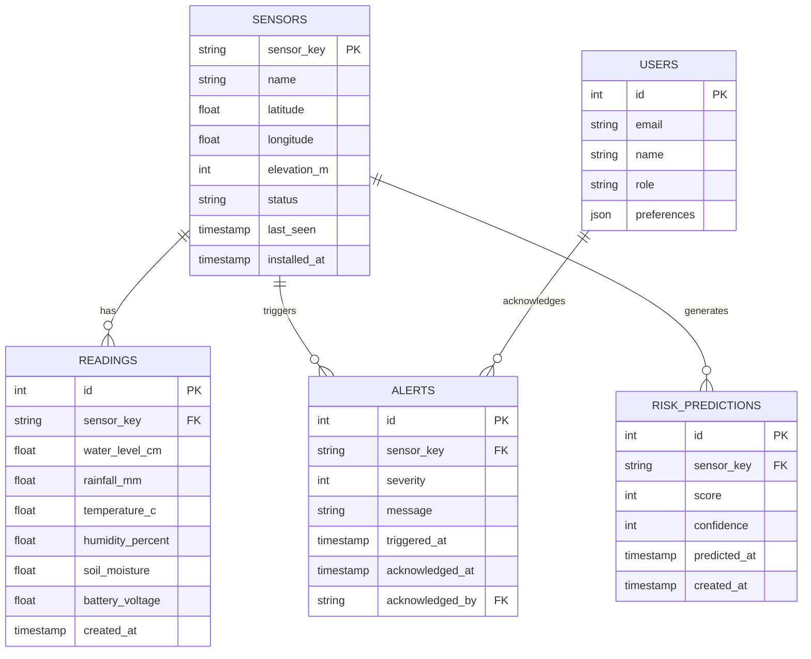
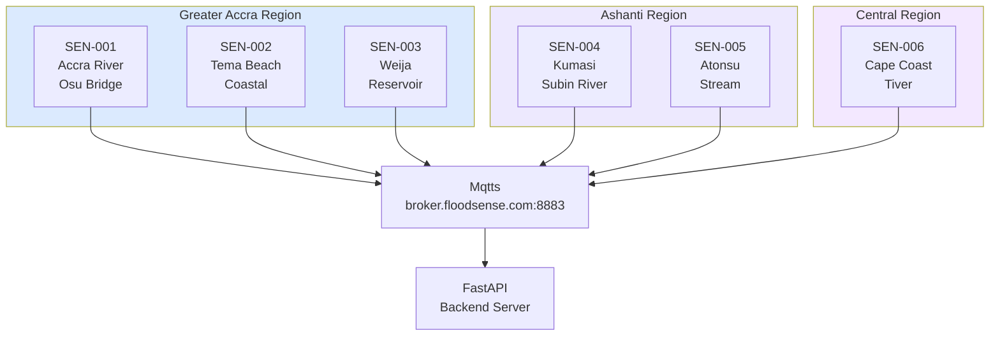

# Visual Diagrams - FloodSense Ghana

Mermaid diagrams ready for export to Draw.io, Figma, and other visualization tools.
Copy any diagram below and paste into Draw.io (Arrange → Insert → Advanced → Mermaid) for visual editing.

---

## 1. System Architecture Diagram (7-Layer)

```mermaid
graph TB
    subgraph Presentation["Presentation Layer"]
        WEB[Web Dashboard - React + Leaflet]
        MOBILE[Mobile App - Responsive]
        SMS[SMS/WhatsApp Alerts]
        EMAIL[Email Notifications]
    end
    
    subgraph API["API & Orchestration Layer"]
        AUTH[Authentication - JWT/OAuth2]
        ROUTE[Request Routing & Validation]
        LIMIT[Rate Limiting & Middleware]
        ERROR[Error Handling & Logging]
    end
    
    subgraph App["Application & Business Logic Layer"]
        DP[DataPipeline - validation, cleaning]
        PS[PredictionService - ML inference]
        AS[AlertService - generation, dispatch]
        SS[SensorService - registration, management]
        AIS[AnalyticsService - trends, reports]
    end
    
    subgraph Data["Data Persistence Layer"]
        PGS[PostgreSQL Database]
        PG1[Sensors Table]
        PG2[Readings Table]
        PG3[Risk Predictions]
        PG4[Alerts Table]
        PG5[Users & Permissions]
    end
    
    subgraph Cache["Cache Layer"]
        REDIS[Redis Cache]
        RED1[Risk Scores]
        RED2[Sensor Status]
        RED3[User Sessions]
        RED4[Dashboard State]
    end
    
    subgraph MQ["Message Queue Layer"]
        MQTT[MQTT Broker - Mosquitto]
        MQ1[/sensors/+/readings]
        MQ2[/alerts/+]
        MQ3[/risks/+]
    end
    
    subgraph IoT["IoT & External Data Layer"]
        SENSORS[Sensor Nodes - ESP32]
        WEATHER[OpenWeather API]
        SATELLITE[GPM Satellite Data]
        TWILIO[Twilio SMS Gateway]
        WHATS[WhatsApp API]
        SENDGRID[SendGrid Email]
    end
    
    WEB <-->|HTTP/WebSocket| API
    MOBILE <-->|HTTPS| API
    API <-->|SQL| Data
    API <-->|Cache| Cache
    Data <-->|Pub/Sub| MQ
    Cache <-->|Pub/Sub| MQ
    MQ <-->|MQTT| IoT
    IoT -- MQTT/Readings
    
    style Presentation fill:#e0f2fe
    style API fill:#bae6fd
    style App fill:#7dd3fc
    style Data fill:#38bdf8
    style Cache fill:#0ea5e9
    style MQ fill:#0284c7
    style IoT fill:#0369a1
```

---

## 2. Sensor Node Circuit Diagram



---

## 3. Deployment Architecture (Cloud)

```mermaid
graph TB
    subgraph INTERNET["Internet"]
        USERS[Users<br/>Desktop/Mobile]
        IOTNODES[IoT Nodes<br/>ESP32]
    end
    
    subgraph CLOUD["Cloud Platform<br/>(GCP/AWS/Firebase)"]
        CDN[CDN - Cloudflare]
        GATEWAY[API Gateway<br/>HTTPS:443]
        
        subgraph BACKEND["Backend Services"]
            API[FastAPI Containers<br/>Auto-scaling]
            LOAD[Load Balancer]
            API -.-> LOAD
            
            subgraph DATABASE["Data Layer"]
                PGDB[PostgreSQL<br/>Managed (Master)]
                REDISCLOUD[Redis Cache<br/>MemoryStore]
            end
            
            subgraph MESSAGING["Messaging Layer"]
                PUBSUB[Pub/Sub<br/>or MQTT Broker]
            end
            
            subgraph ML["ML Services"]
                MODEL[TensorFlow<br/>Model Server]
                TRAIN[Batch Training]
            end
            
            subgraph MONITOR["Monitoring"]
                LOGS[Cloud Logging]
                TRACE[Cloud Trace]
                MONITORING[Cloud Monitoring]
            end
        end
    end
    
    USERS -->|HTTPS| CDN
    CDN --> GATEWAY
    GATEWAY --> BACKEND
    
    IOTNODES -->|MQTT/TLS| PUBSUB
    
    BACKEND -->|SQL| PGDB
    BACKEND -->|Cache| REDISCLOUD
    BACKEND -->|Events| PUBSUB
    BACKEND -->|Predictions| ML
    
    style CLOUD fill:#f3e8ff
    style BACKEND fill:#e9d5ff
    style DATABASE fill:#c084fc
```

---

## 4. CI/CD Pipeline



---

## 5. End-to-End Flood Alert Flow



---

## 6. Network Architecture



---

## 7. Microservices Architecture (Future)



---

## 8. Database ER Diagram



---

## 9. Sensor Network Topology



---

## 10. Dashboard Wireframe - Home

```mermaid
graph TD
    subgraph DESKTOP["Desktop Layout - 1200px+"]
        HEADER[Header<br/>Logo | User Menu | Notifications]
        
        subgraph MAIN["Main Content"]
            COL1[Column 1 - 2/12]
            SIDEBAR[Sidebar Navigation]
            
            COL2[Column - 10/12]
            GRID1[4 Metric Cards<br/>Sensors | Alerts | Risk | Battery]
            MAP[Interactive Leaflet Map<br/>with Risk Markers]
            ALERTS[Recent Alerts Timeline]
            HEALTH[System Health Indicators]
        end
    end
    
    HEADER -.-> MAIN
    MAIN -.-> SIDEBAR
    GRID1 -.-> MAP
    MAP -.-> ALERTS
    ALERTS -.-> HEALTH
```

---

## 11. Dashboard Wireframe - Sensor Detail

```mermaid
graph TD
    HEADER[Header<br/>Back | Sensor Name | Status]
    
    subgraph SENSOR_DETAIL["Sensor Detail Page"]
        LIVE[Live Readings<br/>Water | Rain | Temp | Humidity<br/>Soil | Battery]
        RISK[Risk Assessment<br/>Score | Confidence | Prediction<br/>Factors | Actions]
        CHART[Trend Charts<br/>Water Level | Rainfall<br/>7/30/YTD Tabs]
        FORECAST[24h Forecast<br/>Hourly Predictions]
        HEALTH[Device Health<br/>Uptime | Firmware<br/>Calibration<br/>Maintenance]
    end
    
    HEADER --> LIVE
    LIVE --> RISK
    RISK --> CHART
    CHART --> FORECAST
    FORECAST --> HEALTH
```

---

**Diagram Version:** 1.0  
**Last Updated:** 4 July 2026  
**Format:** Mermaid.js (compatible with Draw.io, Figma, GitHub)  
**Usage:** Copy any diagram block and paste into visualization tool for editing